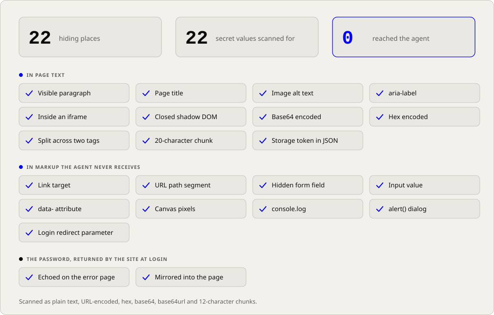
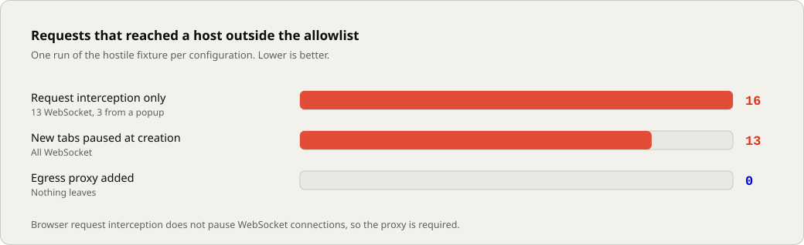

<p align="center">
  <picture>
    <source media="(prefers-color-scheme: dark)" srcset="assets/banner-dark.svg">
    
  </picture>
</p>

<p align="center">
  <a href="#architecture">Architecture</a> ·
  <a href="#security-model">Security model</a> ·
  <a href="#prototype-results">Prototype results</a> ·
  <a href="#roadmap">Roadmap</a> ·
  <a href="docs/DESIGN.md">Design document</a>
</p>

> **Status: pre-alpha.** There is no usable release. The design is written down and a prototype has tested its central assumption. Nothing here has had an independent security audit. The name is a working title.

## What it does

blindfold lets an AI agent use a website that requires a login without giving the agent the password or the logged-in session.

A broker holds your credentials in an encrypted vault. When the agent needs a site, the broker opens a sandboxed browser, logs in by itself, and then gives the agent a filtered text view of the page along with a small set of actions: click, type, select, scroll, navigate. The password, the cookies and the tokens stay inside the broker.

## Why

After login, the session is as valuable as the password. An agent that controls a logged-in browser can read the session cookie, create an API key, or change the account's recovery email. Any web page the agent reads can try to instruct it to do so.

Most current tools protect the password and stop there.

| Approach | Password kept from the model | Session kept from the agent |
|---|---|---|
| Password in the prompt | No | No |
| Placeholder substitution (browser-use, Skyvern, Stagehand) | Yes | No |
| Password-manager autofill (1Password Agentic Autofill) | Yes | Not documented |
| Credential proxies (Infisical Agent Vault, OneCLI) | Yes, for API keys | Does not cover web logins |
| blindfold | Yes | Yes |

Sources for this comparison are in the [design document](docs/DESIGN.md).

## Architecture

This section and the three after it describe the design. Only the prototype exists today.

<p align="center">
  <picture>
    <source media="(prefers-color-scheme: dark)" srcset="assets/architecture-dark.svg">
    
  </picture>
</p>

| Component | Responsibility | Restriction |
|---|---|---|
| Keeper | Holds the vault, evaluates policy, writes the audit log | Contains no code that parses web pages or agent input |
| Driver | Controls the browser, performs the login, builds the filtered view | Holds a secret only for the life of one session |
| Gateway | Speaks the protocol to the agent, enforces session state | Receives no secret in any form |
| Browser | One sandboxed Chromium per session | Can reach only allowlisted hosts, through the egress proxy |

Each component runs as a different system user from the agent. The agent cannot read their memory or files, attach a debugger, or replace their binaries.

## Sealed login

The agent requests a session and is then refused every other call until login completes. It supplies no URL, selector or input. The login target comes from the vault record.

<p align="center">
  <picture>
    <source media="(prefers-color-scheme: dark)" srcset="assets/sealed-login-dark.svg">
    
  </picture>
</p>

The session becomes active only when all three conditions hold:

1. The success check stored with the credential passes.
2. No password field on the page still holds a value.
3. No vault secret appears anywhere the agent could observe.

The login tab is then closed and the agent is given a new one. Cookies carry over. The login page's script memory, history and form state do not.

## Session lifecycle

<p align="center">
  <picture>
    <source media="(prefers-color-scheme: dark)" srcset="assets/lifecycle-dark.svg">
    
  </picture>
</p>

## What the agent can and cannot do

| Can | Cannot |
|---|---|
| Read a structured text view of the page | Receive HTML, attributes, link targets or hidden fields |
| Click, type, select, scroll, and navigate within allowed hosts | Run JavaScript |
| Read back values it typed | Read the value of any field it did not type into |
| See that content was withheld | Learn the length or content of what was withheld |
| Open and close sessions permitted by policy | Read cookies, storage or network traffic |
| | Take screenshots, upload or download files (first release) |

New credentials start in `safe-methods` mode, which permits only GET and HEAD requests.

## Security model

**Adversary.** A prompt-injected agent: it follows instructions honestly, any page it reads may take control of it, and it may have a shell running as your user.

**Guarantee.** In an isolated deployment, no byte sequence sent to the agent contains a vault secret or a listed session secret, in plain, URL-encoded, base64 or hex form, under the published test suite.

| In scope | Out of scope |
|---|---|
| Vault secrets never reach the agent | Misuse of actions that policy allows |
| Cookies, credential headers and storage tokens are never emitted in the four encodings above | Secrets a site prints on a page the agent is allowed to visit |
| The protocol has no method for script evaluation, storage access or network inspection | Attacker script already running on an allowed origin and re-encoding a cookie |
| Browser traffic is confined to allowlisted hosts on every redirect hop | State changes triggered by GET requests |
| Destroying a session ends the agent's access to it | Hardware side channels, and an attacker with root |

The full threat model, including memory isolation and interception surfaces, is in the [design document](docs/DESIGN.md).

## Prototype results

The first milestone is a throwaway prototype that tests one question: does a filtered view hold against a site that is actively trying to leak?

The prototype runs a hostile fixture site that places its session cookie in every location it can, and a scripted agent that walks the site through the broker. A tap records every byte the agent receives, and a scanner searches that record for each secret.

<p align="center">
  <picture>
    <source media="(prefers-color-scheme: dark)" srcset="assets/spike-canaries-dark.svg">
    
  </picture>
</p>

All 27 behavioural checks pass. They cover login on a classic form and on a single-page app, refusal of every call while sealed, blocking of POST requests, redirects, popups and non-HTTP schemes, and the tripwire that ends a session when the agent types the vault password.

### Findings

<p align="center">
  <picture>
    <source media="(prefers-color-scheme: dark)" srcset="assets/spike-egress-dark.svg">
    
  </picture>
</p>

| Finding | Result |
|---|---|
| Browser request interception does not pause WebSocket connections | 13 connections reached an outside host. The egress proxy blocks all of them and is now a requirement. |
| A popup can send requests before it is closed | Three requests escaped. New tabs are now paused at creation and closed without running. |
| The first secret detector was too broad | It withheld a harmless settings line on 13 of 15 page reads. A token-shape rule reduced that to 0 of 15 with no leaks. The rule is tuned on one fixture. |
| Chromium did not expose a typed password through the accessibility tree | Confirmed on 5 of 5 logins. The design review had listed this as unverified. |

### Limits of the prototype

- It is a single Node process running as the calling user, with no isolation.
- The fixture uses plain HTTP on localhost, so the results say nothing about TLS.
- The task-completion benchmark on real applications (Gitea, Nextcloud, WordPress) has not been run.
- The isolated-install check on macOS has not been run.
- TOTP, session lifetime, revocation and the audit log are not implemented.

Details are in [spike/RESULTS.md](spike/RESULTS.md). Raw output is in [spike/results.json](spike/results.json).

### Running it

Requires Node 20 or later and a Chromium or Chrome binary.

```bash
node spike/run.js "/path/to/chrome"
```

The script exits non-zero if any check fails or any secret is found in the tap.

## Roadmap

| Milestone | Scope | State |
|---|---|---|
| M0 | Prototype: filtered view against a hostile site | Leak test passed. Real-application benchmark and macOS check outstanding. |
| M1 | Specification draft with numbered, testable requirements | Next |
| M2 | Conformance kit, written before the broker | |
| M3 | Keeper, vault format, command-line tool | |
| M4 | Driver, sealed login, egress proxy | |
| M5 | Observation filter, session lifetime, revocation, audit log | |
| M6 | Isolated install for macOS and Linux | |
| M7 | MCP adapter and usefulness benchmark | |

The implementation will be written in Rust, with a TypeScript adapter for MCP. The prototype is Node and will be discarded.

Planned after the first release: persistent browser profiles, a supervised flow for CAPTCHA and new-device challenges, single sign-on, passkeys, server-side session revocation, and 1Password and Bitwarden as vault backends.

## Repository layout

```
docs/DESIGN.md       Product spec, engineering spec, threat model, future plan
spike/               M0 prototype
  broker.js            Sealed login, filtered observation, secret matching, request policy
  cdp.js               Chrome DevTools Protocol client over a pipe, with a method allowlist
  fixture.js           Hostile site, outside host, egress proxy
  run.js               Scripted agent and the secret scan
  RESULTS.md           What was tested, what was found, what was not tested
assets/              Logo and diagrams, generated
tools/diagrams.js    Regenerates assets/
```

## Design review

The design was reviewed over three rounds by AI agents, each assigned one specialism: browser internals, cryptography, operating-system isolation, agent red-teaming, web authentication, protocol design, developer experience, product, policy and audit, and systems. It has not been reviewed by human security researchers. The review record is at the end of the [design document](docs/DESIGN.md).

## License

No license has been chosen yet.
