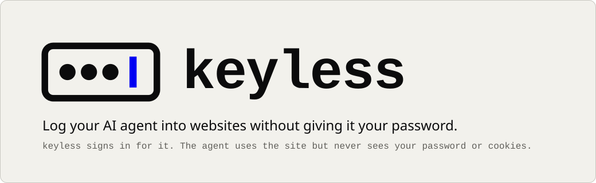
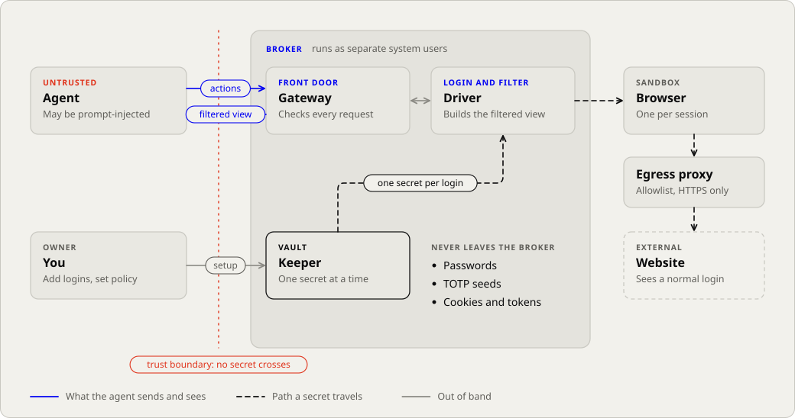
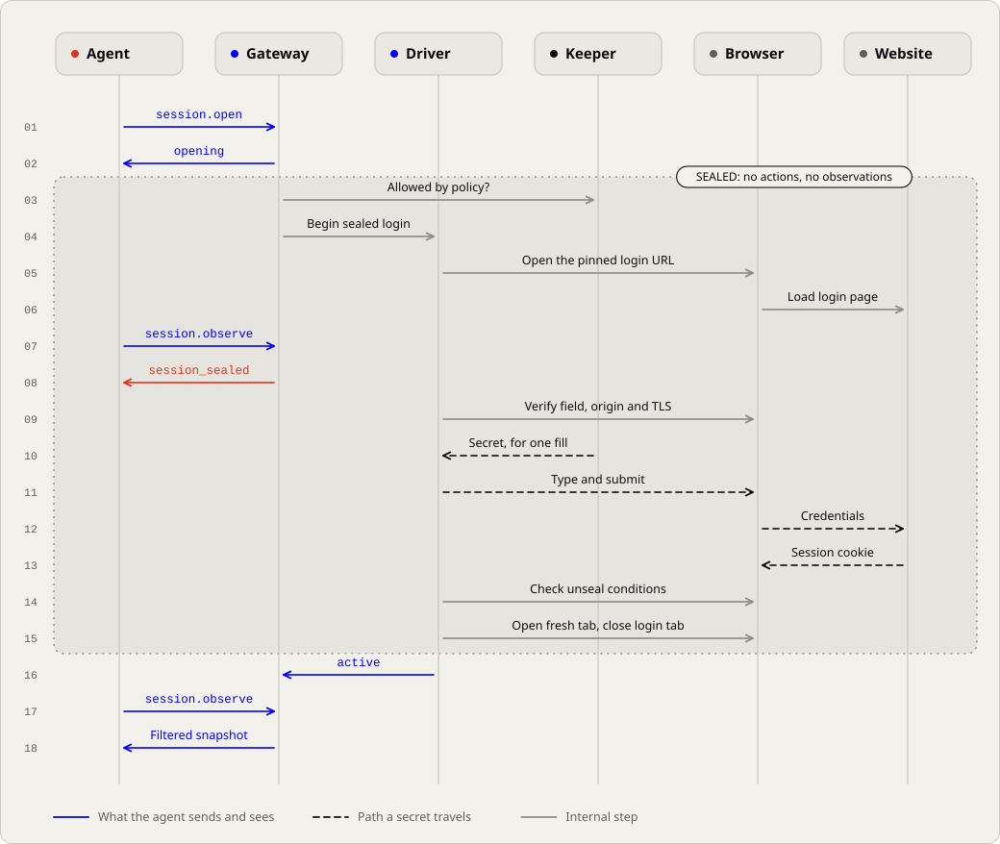
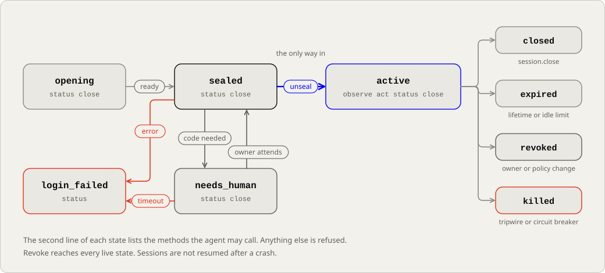

<p align="center">
  <picture>
    <source media="(prefers-color-scheme: dark)" srcset="assets/banner-dark.svg">
    
  </picture>
</p>

<p align="center">
  <a href="#architecture">Architecture</a> ·
  <a href="#security-model">Security model</a> ·
  <a href="#prototype-results">Prototype results</a> ·
  <a href="docs/DESIGN.md">Design</a> ·
  <a href="docs/TRADEOFFS.md">Tradeoffs and gaps</a>
</p>

# keyless

keyless is a local broker that logs AI agents into websites. The broker fills in the password, holds the session cookies and gives the agent a filtered text view of the page to click and type in.

## Status

Pre-alpha. The repository holds a Rust prototype that runs the broker against a local hostile-site fixture, and the design for the production system in [docs/DESIGN.md](docs/DESIGN.md).

Most of this README describes the design. The production broker (separate service users, the vault, TOTP, revocation, the MCP adapter) does not exist yet; [docs/TRADEOFFS.md](docs/TRADEOFFS.md) lists what is missing. Nobody has audited the code. The prototype runs as your own user, so an agent with a shell can read its memory.

## Run

You need Rust 1.88 or newer and a Chrome or Chromium binary.

```bash
cargo build
cargo test
cargo run --bin spike -- /path/to/chrome
cargo run --bin diagrams
cargo run --bin jev-eval          # needs TYPESAFE_API_KEY
```

`spike` runs the hostile-site fixture and writes its results to `spike/results-rust.json`. `diagrams` regenerates the SVGs in `assets/`.

## Architecture

The broker is three services and a browser, each running as its own system user, so a compromised agent cannot reach the parts that hold secrets.

<p align="center">
  <picture>
    <source media="(prefers-color-scheme: dark)" srcset="assets/architecture-dark.svg">
    
  </picture>
</p>

| Component | Does | Has no access to |
|---|---|---|
| Keeper | Vault, authorisation, audit log | Web pages or the agent protocol |
| Driver | Login, browser control, filtering, secret matching, egress proxy | Credentials for other sessions |
| Gateway | Agent protocol, schemas, session state | Credentials |
| Browser | One sandboxed Chromium per session | Hosts outside the allowlist |

Everything is written in Rust. The MCP adapter will use the official [`rmcp`](https://github.com/modelcontextprotocol/rust-sdk) SDK.

## Sealed login

The broker picks the login page from the stored credential, so the agent cannot point it at a phishing form. During login the agent gets no observations and can take no actions.

<p align="center">
  <picture>
    <source media="(prefers-color-scheme: dark)" srcset="assets/sealed-login-dark.svg">
    
  </picture>
</p>

The session unseals once the stored success assertion matches, the password fields are empty and a scan of the page finds no secrets. The broker then opens a fresh tab at the post-login URL, closes the login tab and checks the assertion again. Cookies carry over; script state and form history from the login page are dropped.

## Session lifecycle

<p align="center">
  <picture>
    <source media="(prefers-color-scheme: dark)" srcset="assets/lifecycle-dark.svg">
    
  </picture>
</p>

Sessions expire on a local timer and the owner can revoke them at any time. The prototype covers part of this diagram; [tradeoffs and gaps](docs/TRADEOFFS.md) says which part.

## Agent interface

The agent gets a structured text snapshot of the page and six actions: `click`, `type`, `select`, `scroll`, `navigate` and `wait`. Element references are tied to the snapshot they came from. The agent can read back text it typed itself, but fields the broker filled stay hidden.

There is no script evaluation, raw HTML, attribute access, link targets, hidden fields, cookies, storage or network inspection. Screenshots and file transfers are left out of the first version. Withheld content shows up as a fixed marker that does not reveal its length.

New credentials start on the `safe-methods` policy, which allows GET and HEAD only. Some sites change state on GET, so this cuts down writes rather than blocking them.

## Request gate

After login, every page load, form submission and API call the agent's page makes passes four layers. Only the first can allow a request; the others can only send it to you.

1. **Hard rules:** the host allowlist, URL schemes and the method mode.
2. **Patterns:** paths, form fields and button labels for API tokens, keys, OAuth consent, device sign-in, account security, forwarding, webhooks, exports and deletes.
3. **Classifier (optional):** [Jev](https://docs.typesafe.ai) gets a summary built by the broker (method, URL shape, field names, the clicked label and the page title, never values) and can only flag a request. If it fails or times out, you get asked.
4. **Owner:** you allow or block the request outside the agent's reach. With no way to ask, escalated requests are refused.

The agent gets back `refused: ["needs_owner"]`. On credential and account pages, any new token-shaped value is withheld from what the agent sees, because the matcher doesn't know a token the site just created.

To try it with a real agent, see [docs/DOGFOOD.md](docs/DOGFOOD.md).

## Security model

We assume the agent is prompt-injected and will use every tool it has, including a shell running as its own user. In the production setup, no user the agent can act as is able to read the broker's memory or files, change its code or config, or drive the browser directly.

The goal is that no vault secret or session secret ever shows up on the agent channel, in plain text, URL-encoded, base64 or hex. A conformance suite will test for this. A clean run on test fixtures is good evidence, but it is not proof for every website.

keyless does not protect against:

- an allowed page that displays a freshly created API token;
- a same-origin script that transforms a non-HttpOnly cookie past what the matcher recognises;
- a GET request that changes state;
- the agent misusing a feature policy allows, like sending mail from a webmail account it is logged into.

The full list is in [docs/TRADEOFFS.md](docs/TRADEOFFS.md), and engineering requirements are in [docs/DESIGN.md](docs/DESIGN.md).

## Prototype results

The [legacy JavaScript prototype](spike/RESULTS.md) passed 27 of 27 behavioural checks in both fixture configurations and leaked none of the 22 canaries it scanned for. The Rust port writes its own numbers to `spike/results-rust.json`.

With browser request interception alone, the attacker server received 13 WebSocket upgrades and 16 TCP connections. Adding the egress proxy brought both to zero. The fixture also reproduces three of the known gaps above: a visible API token, a transformed cookie and a state-changing GET. In the Rust run with the request gate, the token is withheld on an owner-approved token page and a "Confirm email" GET is stopped for the owner. A transformed cookie and a state-changing GET with a neutral name (`/prefs/sync`) still get through.

Raw legacy numbers are in [spike/results.json](spike/results.json).

## Repository layout

```text
Cargo.toml           Rust package and binaries
src/                 Prototype and diagram generator
spike/               Fixture reports
assets/              Logo, banners and diagrams
docs/DESIGN.md       Production architecture and requirements
docs/TRADEOFFS.md    Tradeoffs, missing pieces and verification gaps
docs/DOGFOOD.md      Running keyless with a real agent against a local Gitea
scripts/             Dogfood setup
```

## License

The code is licensed under the [Apache License 2.0](LICENSE). The specification's license is still undecided (see [tradeoffs and gaps](docs/TRADEOFFS.md#unresolved-choices)).
